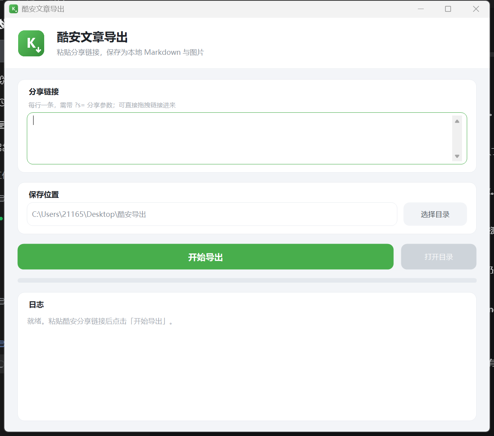

# Coolapk2MD

把**酷安图文文章 / 普通动态**保存成本地 Markdown + 图片。

纯本地运行，不登录、不上传、不联网除下载文章与图片外不做任何请求。



---

## 特性

- **两种形态，功能一致**
  - 图形界面：`Coolapk2MD.exe`，105 KB，双击即用，Win10/11 免安装
  - 命令行：`coolapk2md.py`，零第三方依赖，Python 3.8+
- **完整还原内容**
  - 标题、作者、发布时间、发布机型、原文链接
  - 正文段落、硬换行、超链接、行内代码样式
  - 封面图与正文配图，按阅读顺序编号
- **两种页面结构都支持**
  - 图文长文（`feed-article-message`）
  - 普通动态（`feed-message`，配图在 `message-image-group` 里）
- **工程细节**
  - 图片按真实字节修正扩展名（服务端有时用 `.jpg` 名义返回 PNG）
  - 下载失败重试 3 次，仍失败则保留原始 URL，不丢内容
  - 行首 `#` `>` `|` `-` 等字符自动转义，避免被误渲染
  - 输出 UTF-8 无 BOM，兼容 Obsidian / Typora / VS Code
- **界面**
  - 卡片式布局、统一圆角、微软雅黑
  - 高 DPI 自适应（100%–200% 按物理像素渲染，不做位图拉伸）

---

## 快速开始

### 一、直接用（Windows）

1. 下载 `dist/Coolapk2MD.exe`
2. 双击运行
3. 在酷安 App 里打开文章 → 右上角分享 → **复制链接**
4. 粘贴进窗口，选保存目录，点「开始导出」

> 需要 .NET Framework 4.8。Win10 1903+ 与 Win11 已内置，Win7 需单独安装。

### 二、命令行（Python）

```bash
# 单篇
python src/coolapk2md.py "https://www.coolapk.com/feed/72078845?s=NTQy..."

# 多篇
python src/coolapk2md.py "URL1" "URL2"

# 指定输出目录
python src/coolapk2md.py -o "D:\Notes\酷安" "URL"

# 从文件批量读取（一行一条，# 开头为注释）
python src/coolapk2md.py -f urls.txt
```

exe 同样支持命令行模式，便于批处理：

```bat
dist\Coolapk2MD.exe --cli "https://www.coolapk.com/feed/72078845?s=xxx" "D:\输出目录"
```

### 三、自己编译

不需要 Visual Studio，用系统自带的 C# 编译器即可：

```bat
scripts\build.bat
```

产物输出到 `dist\Coolapk2MD.exe`。详见 [编译说明](#编译说明)。

---

## 为什么链接必须带 `?s=`

酷安网页版对没有分享令牌的链接只返回一张壳页：

> 您当前查看的是「图文分享」，请用酷安手机APP扫码查看详情

实测结论：

| 请求 | 结果 |
| --- | --- |
| `feed/{id}` 裸链接（浏览器 UA / Googlebot / Bingbot / 百度 UA） | 壳页 |
| `feed/{id}?s={token}`，token 与 id 匹配 | **完整正文** |
| `feed/{其它id}?s={token}`，token 与 id 不匹配 | 壳页 |
| `api.coolapk.com/v6/feed/detail` | 403，需 App 签名 |
| 作者主页 `/u/{uid}`、首页 | 壳页 |

令牌**绑定 feed id，不绑定 UA 和 IP**。所以只要在 App 里分享一次拿到的链接，就能重复使用；
裸 id 或从地址栏直接复制的链接拿不到正文，工具会给出明确提示。

更详细的分析见 [docs/technical.md](docs/technical.md)。

---

## 输出格式

```
酷安导出/
└── ColorOS 移植教程/
    ├── index.md
    └── images/
        ├── 01.jpg      # 封面
        ├── 02.jpg      # 正文配图，按阅读顺序编号
        └── ...
```

`index.md` 结构：

```markdown
---
title: "ColorOS 移植教程"
author: "某个酷安用户"
date: "2025-08-14 21:33"
device: "OnePlus 13"
source: "https://www.coolapk.com/feed/..."
---

# ColorOS 移植教程

> 某个酷安用户｜2025-08-14 21:33｜OnePlus 13

> 原文：https://www.coolapk.com/feed/...

正文第一段……


正文第二段，可以带 **超链接** 与 `行内代码`。
```

文件夹名取文章标题，自动去掉 Windows 非法字符（`\ / : * ? " < > |`），
超长标题截断到 60 字符，重名自动加 `_2`、`_3`。

---

## 已知限制

| 限制 | 说明 |
| --- | --- |
| 必须带 `?s=` | 裸 id 服务端只给壳页，需回 App 重新分享 |
| 评论区 | 网页版不提供，无法导出 |
| 视频 / 动图 | 只导出静态封面 |
| 表情包 | 不下载（`static.coolapk.com/emoticons/`），按 alt 文本保留，如「流泪」 |
| 私有 / 已删除文章 | 无法访问 |

---

## 常见问题

**Q：提示「该链接未携带分享令牌」怎么办？**

在酷安 App 里重新走一次「分享 → 复制链接」，把带 `?s=` 的完整链接贴进来。
注意令牌区分大小写，别手动改动。

**Q：图片下载失败？**

网络问题会重试 3 次。仍失败时 md 里会保留原始图片 URL，正文不丢。
可以稍后重跑，或手动补图。

**Q：导出的 md 在某些编辑器里换行不对？**

正文段内换行使用 Markdown 硬换行（行尾两个空格或 `<br>`），
段落之间用空行分隔。若你的编辑器关闭了硬换行渲染，显示会不同，属正常。

**Q：能批量导出某个作者的所有文章吗？**

不能。网页版作者主页也是壳页，且需要逐篇分享令牌，没有批量接口。

---

## 编译说明

依赖：Windows + .NET Framework 4.x（系统自带 `csc.exe`），**不需要** Visual Studio 或 dotnet SDK。

```bat
C:\Windows\Microsoft.NET\Framework64\v4.0.30319\csc.exe ^
  /target:winexe /out:dist\Coolapk2MD.exe ^
  /win32icon:src\app.ico ^
  /resource:src\app.ico,Coolapk2MD.app.ico ^
  /codepage:65001 /optimize+ ^
  /r:System.dll /r:System.Core.dll /r:System.Windows.Forms.dll /r:System.Drawing.dll ^
  src\Coolapk2MD.cs
```

两个必须注意的点：

1. **`/codepage:65001` 不能省** —— 源码是 UTF-8，缺了它中文全部乱码。
2. **图标必须是 BMP 帧的 ICO** —— csc 的资源编译器不接受 PNG 压缩帧；
   同时 .NET 的 `Icon.ToBitmap()` 也解析不了 PNG 帧（会抛 `ArgumentOutOfRangeException`）。
   仓库里的 `app.ico` 是 16/32/48/64 四个 BMP 帧。

源码基于 C# 5（对应 .NET Framework 4.x 的 csc），不支持字符串插值、`?.`、`nameof` 等新语法。

仓库自带 GitHub Actions 配置（`.github/workflows/build.yml`），
每次 push 会在 `windows-latest` 上自动编译，并把 `dist/Coolapk2MD.exe` 作为构建产物上传。

---

## 项目结构

```
Coolapk2MD/
├── README.md
├── LICENSE
├── CHANGELOG.md
├── .github/
│   └── workflows/build.yml  # CI：Windows 上自动编译并上传产物
├── src/
│   ├── Coolapk2MD.cs      # WinForms 版（自绘圆角控件，约 1750 行）
│   ├── coolapk2md.py      # Python 版（零依赖，约 760 行）
│   └── app.ico            # 应用图标（16/32/48/64 BMP 帧）
├── scripts/
│   ├── build.bat          # 一键编译
│   └── run-python.bat     # Python 版快捷入口
├── dist/
│   └── Coolapk2MD.exe     # 预编译产物
├── docs/
│   ├── ui-preview.png
│   └── technical.md       # 实现细节与踩坑记录
└── examples/
    └── sample-output/     # 输出格式示例
```

---

## 免责声明

本工具仅用于**个人离线备份**自己有权访问的内容。

- 导出的文章版权归原作者所有，请勿二次发布或商用
- 请遵守酷安的用户协议，控制请求频率
- 因使用本工具产生的任何后果由使用者自行承担

---

## License

[MIT](LICENSE)